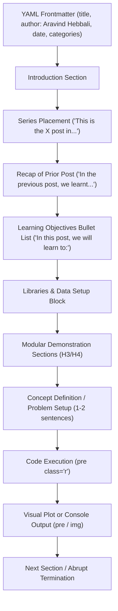

# Written-Voice Profile: Rsquared Academy Blog (Part 1 of 2)

**Date:** 2026-10-30  
**Corpus:** Rsquared Academy Blog (`blog.rsquaredacademy.com`), Slice 1 of 2  
**Commit Inspected:** `git -C F:/R/Others/blogs show e9789df:<path>`  
**Source Manifest:** `F:/pm/notes/2026-10-30-style-audit/rsa-posts-1.txt` (40 posts)  
**Spoken Reference:** `F:/pm/notes/2026-10-28-voice-profile.md`  
**Clarity Reference:** `F:/pm/notes/2026-10-30-style-audit/williams-checklist.md` (Joseph M. Williams, *Style: Lessons in Clarity and Grace*)  
**Output Report:** `docs/voice-rsa-blog-1.md`

---

## Executive Summary & Corpus Overview

This profile examines 40 tutorial and technical posts published on the Rsquared Academy blog between March 2017 and January 2022. Every file was read from the pre-agent repository commit `e9789df`. 

- **Total Posts Evaluated:** 40
- **Total Posts Read Successfully:** 40 (0 unreadable, 0 failed)
- **Guest Posts:** 0. All 40 posts are authored by Aravind Hebbali (`author: Aravind Hebbali`).
- **Total Prose Words:** 46,808 words
- **Total Prose Paragraphs:** 1,358
- **Total Prose Sentences:** 2,701
- **Total Bullet / List Items:** 1,272
- **Total Headings:** 882
- **Total Code Blocks:** 1,457

Aravind Hebbali's written voice in this tutorial corpus is disciplined, transparent, calm, and intensely learner-centric. He writes as an instructor standing side-by-side with the student at the terminal or console. He avoids self-indulgent personal anecdotes, humor, and hype, constructing instead a reliable cadence of bite-sized prose paragraphs that prime the reader before executing code.

---

## 1. Person and Stance

### 1.1 First-Person Plural as the Pedagogical Default (`we` / `us` / `our`)
The defining grammatical stance of the blog is first-person plural (`we`: 993 occurrences; `us`: 362 occurrences; `our`: 90 occurrences). This is not the royal "we" of academic pretension, but the inclusive, collaborative "we" of a shared workshop. The instructor and student examine the data and execute commands together.

- `posts/axis-plot-labels/index.qmd:27`  
  > "In the previous post, we learnt about aesthetics. In this post, we will learn to:"
- `posts/axis-plot-labels/index.qmd:39`  
  > "Let us start with a simple scatter plot. We will continue to use the mtcars data set and examine the relationship between displacement and miles per gallon using geom_point()."
- `posts/ggplot2-scatter-plots/index.qmd:27`  
  > "In the previous post, we learnt about line graphs. In this post, we will learn to: create scatter plots, map aesthetics to variables..."

### 1.2 Second-Person for Conditions and Decisions (`you` / `your`)
Second-person address (`you`: 345 occurrences; `your`: 32 occurrences) appears whenever the reader must make a choice, set an option, or understand domain constraints. While "we" runs the demo, "you" decides what to do in real-world application.

- `posts/axis-plot-labels/index.qmd:113`  
  > "In certain scenarios, you may want to modify the range of the axis. In ggplot2, we can achieve this using: xlim() ... ylim()."
- `posts/beginners-guide-to-r-package-ecosystem/index.qmd:27`  
  > "You should always look for a package before writing code from scratch. In case you have written your own codes for a new analysis or topic, do share it with the R community by converting the code into a package."
- `posts/customer-segmentation-using-rfm-analysis/index.qmd:159`  
  > "How do we decide on this time frame? It depends on the domain to which we are applying this analysis."

### 1.3 Total Absence of First-Person Singular (`I` / `me` / `my`)
Across all 40 posts (~47,000 prose words), the first-person singular pronoun `I` appears as a personal subject **exactly once**. Aravind never writes about himself, his mood, his background, or his personal opinions. Even in package announcements (`rbin`, `rfm`), he uses "We are happy to introduce". The lone personal instance occurs when narrowing an example output:

- `posts/data-wrangling-with-dplyr-part-3/index.qmd:275`  
  > "In the below example, we extract the device column as a vector. I am using head in addition to limit the output printed."

*(Note: Three other literal "I" matches in raw text were proper nouns: Martin Luther King Jr.'s "I Have a Dream" speech at `handling-date-and-time-in-r/index.qmd:367`, the POSIX acronym expansion at line 421, and the `%I` strptime format flag at line 1180).*

### 1.4 Formality and Register
The register is functional, technical, and respectful. It is neither formal academic prose (no passive hedging like "it is submitted that") nor informal internet banter (no slang, exclamation marks, or jokes). It reads like an exceptionally well-curated reference lab manual.

---

## 2. Sentence and Paragraph Shape

### 2.1 Sentence Length: Distribution and Rhythm
Sentences in prose paragraphs are compact, clear, and predictable.

- **Mean Sentence Length:** 15.09 words
- **Median Sentence Length:** 14 words
- **Standard Deviation:** 8.74 words
- **Interquartile Range:** 25th percentile = 10.0 words, 75th percentile = 19.0 words
- **Distribution:**
  - 1–10 words: 36.0% (terse, functional statements or list lead-ins)
  - 11–20 words: 50.3% (the standard explanation unit)
  - 21–30 words: 11.9% (compound instructions or condition explanations)
  - 31+ words: 1.8% (rare compound explanations)

#### Short Sentence Examples:
- `posts/data-visualization-with-r-scatter-plots/index.qmd:37` (8 words)  
  > "Let us begin with a simple scatter plot."
- `posts/handling-date-and-time-in-r/index.qmd:301` (2 words)  
  > "No. Why?"

#### Long Sentence Examples:
- `posts/data-visualization-with-r-combining-plots/index.qmd:26` (49 words across three clauses)  
  > "The Graphics package offers two methods to combine multiple plots. par() can be used to set graphical parameters regarding plot layout using the mfcol and mfrow arguments. layout() serves the same purpose but offers more flexibility by allowing us to modify the height and width of rows and columns."
- `posts/command-line-basics-for-r-users/index.qmd:1683` (44 words)  
  > "4a5 indicates after line 4 in file 1, add line 5 from file 2 to make both the files identical i.e. add caret which is line 5 in imports_blorr.txt after line 4 in imports_olsrr.txt which will make both the files identical."

### 2.2 Paragraph Shape: Bite-Sized Cognitive Steps
Paragraphs in this corpus are micro-units of prose designed to sandwich code snippets, not dense essays.

- **Mean Sentences per Paragraph:** 1.99 sentences (Median: 2.0 sentences)
- **Mean Words per Paragraph:** 30.02 words (Median: 25.0 words)
- **Maximum Sentences in a Paragraph:** 9 (rare introductory overviews)

A typical paragraph consists of exactly two sentences:
1. Sentence 1 establishes the visual or analytical goal ("In certain scenarios, you may want to modify...").
2. Sentence 2 names the specific R function or argument and points downward ("In the below example, we use...").

### 2.3 Sentence Openers: Heavy Positional Monotony
Sentence openings are heavily stereotyped. The top four initial words account for **43.3%** of all 2,701 prose sentences:

1. **`In` (369 sentences, 13.7%):** "In the below example" (81), "In this post" (50), "In the previous post" (34), "In this section" (22), "In ggplot2" (15).
2. **`The` (341 sentences, 12.6%):** Naming the argument, function, or tool ("The `xlim` argument...", "The `labs()` function...", "The data sets...").
3. **`We` (235 sentences, 8.7%):** Setting the collaborative action ("We will use...", "We can see...", "We have explored...").
4. **`Let` (225 sentences, 8.3%):** "Let us start...", "Let us look at...", "Let us explore...".

Other frequent openers include `It` (143, 5.3%), `If` (123, 4.6%), `To` (93, 3.4%), and `You` (80, 3.0%).

### 2.4 Paragraph Endings
- **69.0% end with a standard period** (937 paragraphs).
- **15.4% end with a colon** (209 paragraphs), acting as an explicit ramp into a code fence, table, or bullet list.
- **Questions are rare overall (0.4%, 5 paragraphs)**, though they cluster heavily in the 2020 dates tutorial.
- **Exclamations are practically absent (0.1%, 2 paragraphs)**. Aravind never shouts or uses excitement punctuation.

---

## 3. How Concepts Are Introduced

### 3.1 The Contract-First Pedagogical Template
Aravind introduces concepts via a rigid structural formula:
1. **Series Context:** Situate the post within the larger curriculum ("This is the X post in the series...").
2. **Prior Knowledge Recap:** Explicitly state what was mastered previously ("In the previous post, we learnt about...").
3. **Bulleted Contract:** A 4- to 8-bullet list outlining every single technique covered in the post ("In this post, we will learn to:").
4. **Prerequisites Block:** Code block loading the required packages and dataset.
5. **Component Demonstrations:** Sequenced H3 sections tackling one function argument at a time.

### 3.2 Definition First vs. Problem First
- **High-level concept / Plot type:** Introduced with a clear, plain definition of what it is and what it reveals.
  - `posts/data-visualization-with-r-histogram/index.qmd:34`  
    > "A histogram is a plot that can be used to examine the shape and spread of continuous data. It looks very similar to a bar graph and can be used to detect outliers and skewness in data."
  - `posts/data-types-in-r/index.qmd:27`  
    > "In this section, we will explore the different data types available in R. Data types are fundamental to any programming language."
- **Specific argument / Option:** Introduced with the practical problem or visual goal first.
  - `posts/axis-plot-labels/index.qmd:113`  
    > "In certain scenarios, you may want to modify the range of the axis."
  - `posts/axis-plot-labels/index.qmd:163`  
    > "If you want to remove the axis labels all together, use the theme() function."
  - `posts/data-visualization-with-r-combining-plots/index.qmd:26`  
    > "Often, it is useful to have multiple plots in the same frame as it allows us to get a comprehensive view of a particular variable or compare among different variables."

### 3.3 Alternation of Prose and Code
Prose and code maintain a strict call-and-response relationship:
- **Heading -> Prose:** 774 transitions (88.9%). A heading is almost never immediately followed by bare code.
- **Prose -> Code:** 685 transitions. Prose serves as the launchpad for the code chunk.
- **Code -> Prose:** 531 transitions. Post-code prose observes the result or introduces the next variant.
- **Code -> Code:** 675 transitions (often code chunk followed immediately by pre-rendered console output or plot).
- **Heading -> Code directly:** Only 97 transitions (11.1%).

Aravind adheres firmly to the principle: **Never run code without stating what it does beforehand.**

---

## 4. Tone and Verbal Habits

### 4.1 Emotional Tone: Patient, Methodical, Welcoming
The tone is calm, earnest, and completely unpretentious.
- **No humor or pop culture:** Zero jokes, puns, or movie references.
- **No hype:** Packages and features are never called "insanely fast", "mind-blowing", or "game-changing". They are described modestly as "useful", "handy", "flexible", or "elegant".
- **Warm hospitality:** Welcoming language occurs primarily at package introductions or comment invitations:
  - `posts/binning-data-with-rbin/index.qmd:28`  
    > "We are happy to introduce the rbin package, a set of tools for binning/discretization of data, designed keeping in mind beginner/intermediate R users."
  - `posts/handling-date-and-time-in-r/index.qmd:1331`  
    > "Try them and let us know if you have any doubts."

### 4.2 Verbal Habits and Recurring Phrases (with Counts)

| Phrase / Formula | Count | Primary Function | Exemplary Citation |
|:---|:---:|:---|:---|
| **`Let us`** | 307 | Universal action initiator | `axis-plot-labels/index.qmd:39`: "Let us start with a simple scatter plot." |
| **`Let's`** | **0** | *Total avoidance of contraction* | *(Zero occurrences in 40 posts)* |
| **`the below [noun]`** | 106 | Indian English spatial pointer | `axis-plot-labels/index.qmd:133`: "In the below example, we limit the range..." |
| **`In this post, we will learn`** | 23 | Introductory agenda marker | `axis-plot-labels/index.qmd:27`: "In this post, we will learn to:" |
| **`In the previous post, we`** | 26 | Prior lesson recap bridge | `ggplot2-line-graphs/index.qmd:27`: "In the previous post, we learnt how to build..." |
| **`Allows us to`** | 23 | Capability explanation | `command-line-basics-for-r-users/index.qmd:3883`: "The -P option allows us to specify..." |
| **`In this section, we`** | 22 | Section-level orientation | `customer-segmentation-using-rfm-analysis/index.qmd:147`: "In this section, we will understand..." |
| **`You can see` / `As you can see`** | 32 | Pointing to visual/printed output | `handling-categorical-data-in-r-part-2/index.qmd:131`: "As you can see, the table is populated..." |
| **`In order to`** | 12 | Teleological explanation | `data-visualization-with-r-bar-plots/index.qmd:108`: "...in order to communicate properly." |
| **`So far`** | 11 | Milestone / checkpoint marker | `handling-date-and-time-in-r/index.qmd:2049`: "So far we have created a single date-time instance." |
| **`Keep in mind`** | 6 | Cautionary flag for pitfalls | `ggplot2-scatter-plots/index.qmd:90`: "Keep in mind that the color argument should be outside aes()." |
| **`Similarly`** | 4 | Parallel pattern reuse | `customer-segmentation-using-rfm-analysis/index.qmd:228`: "Similarly, Jaineel and Taj are assigned the scores 5 and 1." |
| **`Bare bones`** | 1 | Minimalist baseline idiom | `data-visualization-with-r-histogram/index.qmd:62`: "...to create a bare bones histogram..." |

---

## 5. Vocabulary and Usage

### 5.1 Technical Level and Domain Jargon
Aravind writes for beginners and intermediate practitioners. He avoids high-order mathematical abstractions, focusing instead on observable computational mechanics:
- In RFM segmentation (`posts/customer-segmentation-using-rfm-analysis/index.qmd`), he explains customer quantile scores via concrete tabular illustrations rather than mathematical formulas.
- In `rbin` discretization (`posts/binning-data-with-rbin/index.qmd`), he explains binning as "dividing continuous variables into intervals or cut points".
- In `command-line-basics-for-r-users/index.qmd`, he provides explicit terminal flag tables before running curl, wget, or grep.

### 5.2 British / Commonwealth vs. US Spelling
Aravind shows a pronounced, systematic preference for British/Commonwealth spelling in descriptive prose, coexisting with US spelling where R programming syntax mandates it:
- **`learnt` (56) vs. `learned` (6):** Overwhelmingly British (`axis-plot-labels/index.qmd:27`: "we learnt about aesthetics").
- **`color` (116) vs. `colour` (1):** US `color` dominates purely because of R function arguments (`col =`, `color =`), though he notes British `colour` once as a ggplot2 alias (`ggplot2-introduction-to-aesthetics/index.qmd:99`).
- **`summarise` (3) vs. `summarize` (5):** Mixed; influenced by dplyr's dual verbs.
- **`practice` (12) vs. `practise` (0):** Standardized noun usage.

### 5.3 Indian English Markers
Three distinct Indian English syntactic and lexical patterns appear in the text:
1. **`the below [noun]` as an adjective (106 occurrences):**  
   In standard US/UK English, "below" is an adverb placed after the noun ("in the example below", "the table below"). Aravind consistently places it before the noun:
   - `posts/axis-plot-labels/index.qmd:133`: "In the below example, we limit the range..."
   - `posts/command-line-basics-for-r-users/index.qmd:614`: "The below table shows commands for changing working directory..."
2. **Plural count noun `codes` (5 occurrences):**  
   In standard English, "code" is an uncountable mass noun. In Indian English, source code files or scripts are frequently pluralized as "codes":
   - `posts/beginners-guide-to-r-package-ecosystem/index.qmd:27`: "In case you have written your own codes for a new analysis or topic, do share it..."
   - `posts/data-wrangling-with-dplyr-part-1/index.qmd:40`: "The data sets can be downloaded from here and the codes from here."
3. **`doubts` for questions/queries (1 occurrence):**  
   - `posts/handling-date-and-time-in-r/index.qmd:1331`: "Try them and let us know if you have any doubts."

### 5.4 Favorite & Signature Terms
- **`bare bones`:** Minimal working baseline.
- **`elegant`:** Expressive, clean visualization (`Elegant Data Visualization with ggplot2`).
- **`comprehensive`:** Thorough, end-to-end handbook style.
- **`crucial`:** Highlighting essential domain steps (`rfm-analysis/index.qmd:158`).
- **`syntax` (6x):** Focusing on grammatical correctness in R.

---

## 6. Structure and Document Architecture

### 6.1 Anatomical Structure of a Post
Every post in the slice follows a standardized, modular skeleton:


### 6.2 Structural Statistics (40 Posts)
- **Posts explicitly referencing a 'series' in the opening:** 26 / 40 (65.0%)
- **Posts recapping the 'previous post' in the opening:** 27 / 40 (67.5%)
- **Posts featuring an explicit bulleted agenda:** 37 / 40 (92.5%)
- **Posts ending abruptly after the final code chunk:** 37 / 40 (92.5%)
- **Posts with an explicit 'Summary' section:** 3 / 40 (7.5%)
- **Callout boxes or blockquotes (`> Note:`, `::: callout`):** **0** (Zero used across all 40 posts)

### 6.3 Heading Conventions
Headings are concise, title-cased, and functional:
- Named by visual feature: `### Axis Range`, `### Font Face`, `### Point Color`
- Named by R function or argument: `### ggtitle()`, `### xlim & ylim`, `### names.arg`
- Named by task: `### Remove Axis Labels`, `### Univariate Box Plot`

### 6.4 Further-Reading Pointers
Pointers to outside resources are rare, highly focused, and direct the reader to authoritative primary literature:
- Hadley Wickham’s *R Packages* book (`beginners-guide-to-r-package-ecosystem/index.qmd:27`).
- Official CRAN Task Views (`beginners-guide-to-r-package-ecosystem/index.qmd:27`).
- Hadley Wickham's *ggplot2* documentation and book (`ggplot2-quick-tour/index.qmd:26`).

---

## 7. Traits a Careful Editor Must KEEP

When performing clarity audits (such as the Williams audit), an editor must preserve the essential traits that make Aravind’s teaching effective and recognizable:

1. **The Collaborative Pedagogical Stance ("We" / "Let us"):**  
   Do not convert his inclusive "we" into sterile passive voice or distant third-person. The warmth of his teaching comes from walking beside the reader through the analysis.
2. **The Contract-First Bulleted Learning Objectives:**  
   The 4- to 8-bullet list in section 1 is an invaluable cognitive anchor. Learners rely on it to verify whether the post contains the exact task they need.
3. **The Micro-Paragraph Cadence (Average 2 Sentences, 30 Words):**  
   Do not merge his short paragraphs into dense academic blocks. His paragraphs serve as brief, readable resting points between code executions.
4. **Action Lead-In Before Code Execution:**  
   Keep his habit of explaining what an argument or function will do *before* running it. Never let a code block appear without an introductory sentence.
5. **Direct Coupling of Function Arguments to Graphical Effects:**  
   Preserve his exact mapping sentences ("The `face` argument can be used to modify the font face..."). This explicit linkage is core to his reference value.
6. **Plain Definitions Before Syntax:**  
   Preserve his plain-English definitions of complex tools (histograms, discretization, RFM scores, regex) before throwing syntax at the learner.
7. **Series Continuity and Context:**  
   Keep the explicit links to prerequisite skills ("In the previous post, we learnt..."), which give the blog its cohesive textbook feel.

---

## 8. Habits That Work Against Clarity (Williams Audit Candidates)

These habits recur frequently across the 40 posts and represent primary targets for refinement under Joseph M. Williams' *Style: Lessons in Clarity and Grace*:

### 8.1 Pervasive Metadiscourse / Talk About the Text (295 occurrences)
*Williams Principle 11: Cut talk about the text.*  
Aravind spends excessive sentence real estate announcing what the text has done, is doing, or will do:
- "In the below example/table..." (88 occurrences)
- "In this post..." (87 occurrences)
- "In the previous post..." (30 occurrences)
- "In this section..." (26 occurrences)
- "This is the X post in the series..." (21 occurrences)
- "In the next post/section..." (18 occurrences)
- `posts/axis-plot-labels/index.qmd:27`: "This is the fifth post in the series Elegant Data Visualization with ggplot2. In the previous post, we learnt about aesthetics. In this post, we will learn to:"  
  *(Audit remedy: Condense or eliminate series meta-announcements; get directly to the topic).*

### 8.2 Non-Standard Prepositive Modifier: "the below [noun]" (106 occurrences)
*Williams Principle 18 / Standard Syntax: Clear modifiers.*  
Using "below" as an adjective before nouns creates awkward, non-standard phrasing throughout the blog:
- "In the below example, we..." (82x)
- "The below table shows..." (11x)
- `posts/axis-plot-labels/index.qmd:133`: "In the below example, we limit the range of the X axis..."  
  *(Audit remedy: Change to "In the example below," or recraft as active instruction: "Limit the X axis range with `xlim()`:").*

### 8.3 Overuse of Passive Capability Verbs (131 occurrences)
*Williams Principles 1 & 2: Characters as subjects, actions as verbs.*  
Aravind frequently makes the function or argument the passive recipient of capability rather than stating what it does:
- "can be used" (42x)
- "can be modified" (26x)
- "is used" (24x)
- "can be specified" (14x)
- "can be achieved" (4x)
- `posts/axis-plot-labels/index.qmd:93`: "The labs() function can be used to add the following to a plot:"  
  *(Audit remedy: "`labs()` adds titles and axis labels to a plot:").*
- `posts/axis-plot-labels/index.qmd:230`: "The face argument can be used to modify the font face of the title of the plot."  
  *(Audit remedy: "Use `face` to modify the title's font face:").*

### 8.4 Abstract Nominalizations ("the [noun] of", 68+ occurrences)
*Williams Principle 2: Actions as verbs.*  
Crucial action verbs are frequently buried inside abstract Latinate nouns:
- "the distribution of" (20x)
- "the appearance of" (19x)
- "the location of" (6x)
- "the position of" (5x)
- "the creation of" (2x)
- `posts/axis-plot-labels/index.qmd:193`: "It should be used whenever you want to modify the appearance of any text element of your plot."  
  *(Audit remedy: "Use it to format any text element in your plot.").*
- `posts/data-visualization-with-r-bar-plots/index.qmd:262`: "...to modify and enhance the appearance of the plot."  
  *(Audit remedy: "...to modify and restyle the plot.").*

### 8.5 Weak Sentence Endings / Trailing Stress (52 occurrences)
*Williams Principle 5: Stress at the end.*  
Sentences frequently dribble away with weak qualifiers, dangling method phrases, or filler adverbs:
- "...as well" (37x)
- "...using [function]" (7x dangling method)
- "...respectively" (5x)
- "...etc." (2x)
- `posts/command-line-basics-for-r-users/index.qmd:259`: "You can clear the screen by pressing Ctrl + L as well."  
  *(Audit remedy: "You can also clear the screen with Ctrl + L.").*
- `posts/data-wrangling-with-dbplyr/index.qmd:30`: "In this post, we will learn to query data from a database using dplyr."  
  *(Audit remedy: "In this post, we query a database with dplyr.").*

### 8.6 Throat-Clearing Formulas (50+ occurrences)
*Williams Principles 9 & 10: Cut redundant pairs and padding.*  
Recurring padding phrases delay the delivery of the main action:
- "allows us to" (23x)
- "in order to" (12x)
- "it is important to note that" / "it is important to" (3x)
- `posts/command-line-basics-for-r-users/index.qmd:3883`: "The -P option allows us to specify the directory..."  
  *(Audit remedy: "`The -P option specifies the directory...`").*
- `posts/data-visualization-with-r-bar-plots/index.qmd:108`: "It is important to add appropriate labels to the bars in order to communicate properly."  
  *(Audit remedy: "Clear bar labels are essential for effective communication.").*

### 8.7 Monotonous Sentence Openers
*Williams Principle 14: Vary sentence shape on purpose.*  
With 43.3% of sentences opening with "In", "The", "We", or "Let", reading extended sections can induce syntactic fatigue. Intentionally introducing occasional imperative clauses ("Set `col = 'blue'` to..."), conditional fronting ("When comparing groups..."), or topic-focused openings will improve reading flow without flattening voice.

---

## 9. Written vs. Spoken Profile

Comparing this written slice with the spoken voice profile (`F:/pm/notes/2026-10-28-voice-profile.md`, derived from 7 YouTube videos):

### 9.1 Where Written and Spoken Agree
1. **Uncontracted "Let us":** Both spoken and written modes rely heavily on "let us" (spoken: 40x; written: 307x). Contractions like "let's" are completely avoided in both media.
2. **Teacher Beside the Screen Persona:** Both spoken and written personas are calm, patient, unhurried, devoid of drama, jokes, or self-aggrandizement.
3. **Pointing at Concrete Output:** Spoken uses "Here you can see..."; written uses "As you can see..." (13x), "You can see..." (19x), and "In the below example...".
4. **Step-by-Step Ordinals:** Both signpost structural progressions deliberately ("first", "next", "then").

### 9.2 Where Written and Spoken Differ
1. **Verbal Tics Absent in Writing:**  
   - Spoken "right" (200x sentence-end tag in videos) is **completely absent** in writing (0 occurrences, except for one isolated conversational question in 2020).
   - Spoken "now" (135x sentence opener in videos) is tightly controlled in writing (only 42 occurrences in 2,701 sentences, 1.6%).
   - Spoken "so here" (23x in videos) does not appear in writing.
2. **Document Closings:**  
   - Spoken videos *always* close with an explicit summary, a bridge to practice ("Try out the different options..."), and a teaser for the next video.
   - Written blog posts in this slice almost *never* close gracefully: **37 of 40 posts terminate abruptly** immediately after the final code snippet or plot.
3. **Metadiscourse Agendas:**  
   - The spoken guide strictly warns against long roadmap agendas ("In this module we will cover...").
   - In writing, Aravind embraces agendas: **92.5% of posts feature an explicit bulleted contract** of 4–8 learning objectives.
4. **Spelling and Syntax:**  
   - Written text exhibits strong Commonwealth spelling (`learnt`: 56x) and Indian English prepositive syntax (`the below example`: 82x), which are less conspicuous in audio captions.

---

## 10. Change Over Time (2017 to 2022)

The 40 posts span five distinct years, revealing a clear evolution in Aravind's writing style:

```
2017: 21 posts  ═════════════════════  Base R & ggplot2 series (Rigid template)
2018:  9 posts  ═════════              Tidyverse & data wrangling (Workflow depth)
2019:  4 posts  ════                   Package launches & CLI handbook (Comprehensive)
2020:  2 posts  ══                     Date & Time (Conversational Socratic shift)
2022:  4 posts  ════                   Categorical data (Modular, polished)
```

### 10.1 Chronological Breakdown

#### 2017 (21 Posts: Base R & ggplot2 Foundations)
- **Characteristics:** Highly formulaic. 18 of 21 posts open with the exact boilerplate: "This is the X post in the series... In the previous post, we learnt about... In this post, we will learn to:".
- **Stylistic Markers:** Heaviest reliance on British `learnt` (40x) and Indian English `the below example` (52x). Sentences are compact (mean: 14.6 words). Zero rhetorical questions (only 9 question marks across all 21 posts).

#### 2018 (9 Posts: Tidyverse, Advanced ggplot2 & dbplyr)
- **Characteristics:** Shift from isolated plotting functions to end-to-end data manipulation pipelines (`dplyr`, `dbplyr`, `stringr`).
- **Stylistic Markers:** Prose paragraphs expand to explain multi-step transformations. Series boilerplate remains (5 of 9 posts), but prose engages more with data structures (tibbles, databases).

#### 2019 (4 Posts: Package Announcements & System Handbooks)
- **Characteristics:** Broad-scope, authoritative reference manuals (`binning-data-with-rbin`, `customer-segmentation-using-rfm-analysis`, `command-line-basics-for-r-users`).
- **Stylistic Markers:** Sentences lengthen (mean: 16.5 words). `learnt` drops to 0. RFM analysis incorporates deep business logic (customer lifetime value, transaction recency). CLI handbook introduces detailed command syntax tables.

#### 2020 (2 Posts: Date and Time in R)
- **Characteristics: The Conversational / Socratic Turning Point.**
- **Stylistic Markers:** In `handling-date-and-time-in-r`, Aravind breaks away from passive cataloging and adopts an interactive, dialogic voice. Question marks skyrocket to **33 occurrences in just 2 posts**. For the first time, conversational interjections appear:
  - `handling-date-and-time-in-r/index.qmd:288`: "Why do we see 1995 when we call the date? What is happening here?"
  - `handling-date-and-time-in-r/index.qmd:301`: "Alright, now R does not do any arithmetic and returns the date as we specified. Great! Is this the right format to store date/time then? No. Why?"
  - `handling-date-and-time-in-r/index.qmd:775`: "Now, you have heard of Greenwich Meridian Time (GMT) right?" *(The spoken tag "right?" enters writing!)*

#### 2022 (4 Posts: Handling Categorical Data in R)
- **Characteristics: Mature, Modular Synthesis.**
- **Stylistic Markers:** A balanced, polished instructional style. The awkward `the below example` virtually disappears (dropping to only 3 instances across 4 large posts). Explanations seamlessly blend contingency tables, chi-square contributions, and forcats factor recoding without syntactic clutter.

---

## 11. Complete File Reading Manifest

All 40 files listed in `F:/pm/notes/2026-10-30-style-audit/rsa-posts-1.txt` were read from git commit `e9789df`. Zero files failed to load. Zero guest posts were detected.

| # | File Path | Author | Date | Line Count | Notes |
|:---|:---|:---|:---:|:---:|:---|
| 1 | `posts/axis-plot-labels/index.qmd` | Aravind Hebbali | 2017-11-08 | 304 | Read; ggplot2 series #5 |
| 2 | `posts/beginners-guide-to-r-package-ecosystem/index.qmd` | Aravind Hebbali | 2017-03-13 | 125 | Read; CRAN/GitHub ecosystem guide |
| 3 | `posts/binning-data-with-rbin/index.qmd` | Aravind Hebbali | 2019-03-12 | 28,641 | Read; package release (large dataset output) |
| 4 | `posts/command-line-basics-for-r-users/index.qmd` | Aravind Hebbali | 2019-10-26 | 5,371 | Read; comprehensive CLI handbook |
| 5 | `posts/customer-segmentation-using-rfm-analysis/index.qmd` | Aravind Hebbali | 2019-07-22 | 1,122 | Read; RFM business analysis & package guide |
| 6 | `posts/data-types-in-r/index.qmd` | Aravind Hebbali | 2017-02-17 | 203 | Read; data structures overview |
| 7 | `posts/data-visualization-with-r-bar-plots/index.qmd` | Aravind Hebbali | 2017-07-11 | 263 | Read; base R viz series #5 |
| 8 | `posts/data-visualization-with-r-box-plots/index.qmd` | Aravind Hebbali | 2017-07-23 | 174 | Read; base R viz series #6 |
| 9 | `posts/data-visualization-with-r-combining-plots/index.qmd` | Aravind Hebbali | 2017-09-09 | 438 | Read; base R viz series #10 |
| 10 | `posts/data-visualization-with-r-histogram/index.qmd` | Aravind Hebbali | 2017-08-04 | 201 | Read; base R viz series #7 |
| 11 | `posts/data-visualization-with-r-introduction/index.qmd` | Aravind Hebbali | 2017-05-24 | 159 | Read; base R viz series #1 |
| 12 | `posts/data-visualization-with-r-legends/index.qmd` | Aravind Hebbali | 2017-08-16 | 311 | Read; base R viz series #8 |
| 13 | `posts/data-visualization-with-r-line-graphs/index.qmd` | Aravind Hebbali | 2017-06-29 | 143 | Read; base R viz series #4 |
| 14 | `posts/data-visualization-with-r-scatter-plots/index.qmd` | Aravind Hebbali | 2017-06-17 | 99 | Read; base R viz series #3 |
| 15 | `posts/data-visualization-with-r-text-annotations/index.qmd` | Aravind Hebbali | 2017-08-28 | 152 | Read; base R viz series #9 |
| 16 | `posts/data-visualization-with-r-title-and-axis-labels/index.qmd` | Aravind Hebbali | 2017-06-05 | 143 | Read; base R viz series #2 |
| 17 | `posts/data-wrangling-with-dbplyr/index.qmd` | Aravind Hebbali | 2018-12-09 | 169 | Read; database querying tutorial |
| 18 | `posts/data-wrangling-with-dplyr-part-1/index.qmd` | Aravind Hebbali | 2018-08-23 | 741 | Read; dplyr series #1 |
| 19 | `posts/data-wrangling-with-dplyr-part-2/index.qmd` | Aravind Hebbali | 2018-09-04 | 295 | Read; dplyr series #2 |
| 20 | `posts/data-wrangling-with-dplyr-part-3/index.qmd` | Aravind Hebbali | 2018-09-16 | 371 | Read; dplyr series #3 |
| 21 | `posts/dataframes/index.qmd` | Aravind Hebbali | 2017-05-12 | 122 | Read; data structures overview |
| 22 | `posts/faceting/index.qmd` | Aravind Hebbali | 2018-04-25 | 210 | Read; ggplot2 faceting tutorial |
| 23 | `posts/getting-help-in-r-updated/index.qmd` | Aravind Hebbali | 2019-03-05 | 254 | Read; help functions & documentation |
| 24 | `posts/ggplot2-bar-plots/index.qmd` | Aravind Hebbali | 2017-12-26 | 216 | Read; ggplot2 series #8 |
| 25 | `posts/ggplot2-box-plots/index.qmd` | Aravind Hebbali | 2018-01-07 | 287 | Read; ggplot2 series #9 |
| 26 | `posts/ggplot2-histogram/index.qmd` | Aravind Hebbali | 2018-01-19 | 221 | Read; ggplot2 series #10 |
| 27 | `posts/ggplot2-introduction-to-aesthetics/index.qmd` | Aravind Hebbali | 2017-10-27 | 331 | Read; ggplot2 series #4 |
| 28 | `posts/ggplot2-introduction-to-geoms/index.qmd` | Aravind Hebbali | 2017-10-15 | 331 | Read; ggplot2 series #3 |
| 29 | `posts/ggplot2-line-graphs/index.qmd` | Aravind Hebbali | 2017-12-14 | 228 | Read; ggplot2 series #7 |
| 30 | `posts/ggplot2-quick-tour/index.qmd` | Aravind Hebbali | 2017-10-03 | 145 | Read; ggplot2 series #1 |
| 31 | `posts/ggplot2-scatter-plots/index.qmd` | Aravind Hebbali | 2017-12-02 | 250 | Read; ggplot2 series #6 |
| 32 | `posts/ggplot2-text-annotations/index.qmd` | Aravind Hebbali | 2017-11-20 | 151 | Read; ggplot2 series #5b |
| 33 | `posts/guides-axes/index.qmd` | Aravind Hebbali | 2018-01-31 | 214 | Read; ggplot2 axis scales guide |
| 34 | `posts/hacking-strings-with-stringr/index.qmd` | Aravind Hebbali | 2018-10-22 | 728 | Read; string manipulation tutorial |
| 35 | `posts/handling-categorical-data-in-r-part-1/index.qmd` | Aravind Hebbali | 2022-01-07 | 582 | Read; categorical data series #1 |
| 36 | `posts/handling-categorical-data-in-r-part-2/index.qmd` | Aravind Hebbali | 2022-01-12 | 563 | Read; categorical data series #2 |
| 37 | `posts/handling-categorical-data-in-r-part-3/index.qmd` | Aravind Hebbali | 2022-01-13 | 691 | Read; categorical data series #3 |
| 38 | `posts/handling-categorical-data-in-r-part-4/index.qmd` | Aravind Hebbali | 2022-01-14 | 206 | Read; categorical data series #4 |
| 39 | `posts/handling-date-and-time-in-r-part-1/index.qmd` | Aravind Hebbali | 2020-04-16 | 261 | Read; date-time series part 1 |
| 40 | `posts/handling-date-and-time-in-r/index.qmd` | Aravind Hebbali | 2020-04-17 | 2,618 | Read; comprehensive lubridate handbook |

**Unreadable / Failed Files:** None.
