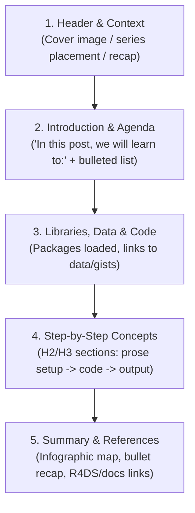
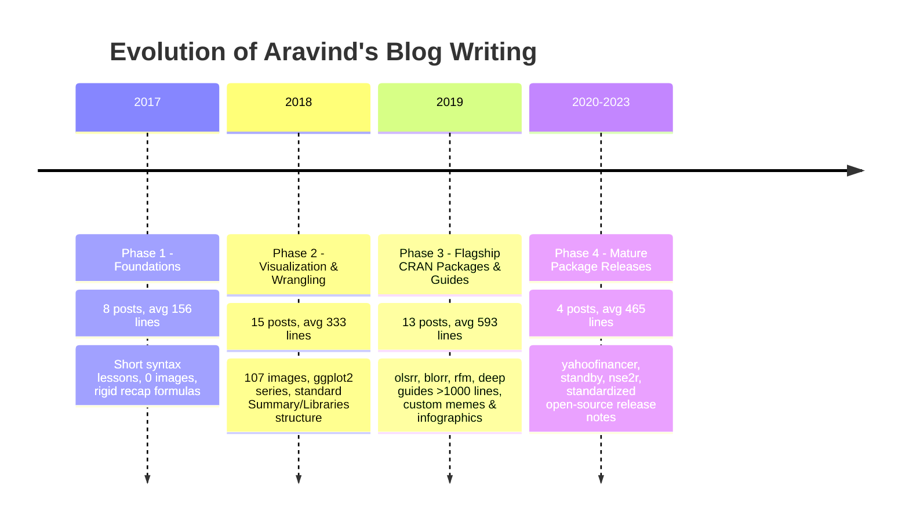

# Written Voice Profile: Rsquared Academy Blog (posts/), Part 2 of 2

**Date:** 2026-10-30  
**Corpus Slice:** Rsquared Academy Blog (`blog.rsquaredacademy.com`), `posts/` slice 2 of 2 (`rsa-posts-2.txt`)  
**Commit Read:** `e9789df` in `F:/R/Others/blogs`  
**Total Posts Analyzed:** 40  
**Excluded / Guest Posts:** None (all 40 posts are authored by Aravind Hebbali)  
**Spoken Reference:** `F:/pm/notes/2026-10-28-voice-profile.md`  
**Clarity Reference:** `F:/pm/notes/2026-10-30-style-audit/williams-checklist.md` (Joseph M. Williams, *Style: Lessons in Clarity and Grace*)  

---

## Executive Summary & Corpus Metrics

This report analyzes the written voice of Aravind Hebbali across 40 posts on the Rsquared Academy blog published between February 2017 and May 2023. These posts span foundational R tutorials (data structures, matrices, factors), tidyverse deep dives (`readr`, `forcats`, `lubridate`, `magrittr`), database querying (`RSQLite`, SQL), visualization series (`ggplot2` legends and themes), and major CRAN package launch announcements authored by Aravind (`olsrr`, `blorr`, `rfm`, `descriptr`, `vistributions`, `pkginfo`, `nse2r`, `yahoofinancer`, `standby`).

```
Total Posts:                   40
Total Raw Source Lines:        15,804
Total Prose Paragraphs:        954
Total Bullet List Items:       1,043
Total R/SQL Code Blocks:       794
Total Output Blocks:           584
Total Rendered Images:         327
Total Prose Sentences:         1,759
Total Prose Words:             27,025
Mean Words Per Sentence (WPS): 15.36
Median Words Per Sentence:     14
Sentence Length Range:         1 to 55 words
```

---

## 1. Person and Stance

### 1.1 The Pedagogical "We" and Collaborative Stance
Aravind writes from an inclusive, collaborative posture. Rather than lecturing from above or commanding with bald imperatives, he routinely adopts the first-person plural (`we`, `us`, `our`), creating a shared journey where teacher and student sit side-by-side at the R console. First-person plural appears in **744 prose sentences** (accounting for **883 pronoun tokens**), representing over 42% of all sentences in the corpus.

- `posts/import-data-into-r-part-1/index.qmd:24`:  
  > "In this post, we will learn to: read data from flat or delimited files..."
- `posts/introduction-to-lists/index.qmd:24`:  
  > "In the previous post, we learnt about matrices. In this post, we will learn about lists. Let us begin by creating a list."
- `posts/working-with-dates-in-r/index.qmd:26`:  
  > "In this post, we will learn to work with date/time data in R using lubridate , an R package..."

### 1.2 Near-Total Absence of the First-Person Singular ("I")
The first-person singular pronoun (`I`, `me`, `my`) is virtually absent from tutorial prose, occurring in only **4 sentences** across the entire 27,000-word corpus (43 total tokens, primarily in GitHub package README boilerplate and author email contact links). Aravind almost never refers to himself in the singular when teaching concepts.

- `posts/introducing-olsrr/index.qmd:24`:  
  > "I am pleased to announce the olsrr package, a set of tools for improved output from linear regression models, designed keeping in mind beginner/intermediate R users."
- `posts/introducing-olsrr/index.qmd:232`:  
  > "For help with code or other related questions, feel free to reach me hebbali.aravind@gmail.com ."
- `posts/introducing-descriptr/index.qmd:860`:  
  > "For help with code or other related questions, feel free to reach me hebbali.aravind@gmail.com ."

### 1.3 Direct Second-Person Reader Address ("You")
Aravind addresses the reader as `you` or `your` in **220 sentences** (267 pronoun tokens). The stance here is encouraging, empathetic, and diagnostic. He anticipates common stumbling blocks, checks understanding, and offers reassuring troubleshooting.

- `posts/import-data-into-r-part-1/index.qmd:98`:  
  > "Great! If you see the above output, you have successfully read data into R. If you see an error message (which most of us see when we are trying to read data for the first time), follow the below instructions:"
- `posts/variables-in-r/index.qmd:24`:  
  > "You can skip this post, if you have prior experience in any other programming language."
- `posts/introducing-blorr/index.qmd:33`:  
  > "If you know how to build models using glm() , you will find blorr very useful."

### 1.4 Formality and Register
The tone is semi-formal, professional, and courteous. Contractions are almost completely eschewed in expository prose (`let us` occurs **190 times**, whereas `let's` occurs **0 times**; `we will` occurs **110 times**, whereas `we'll` occurs only **4 times**). Despite the lack of contractions, the register remains approachable and warm rather than stiff or academic.

---

## 2. Sentence and Paragraph Shape

### 2.1 Sentence Length and Distribution
Sentences are predominantly compact to medium-length, averaging **15.36 words per sentence** with a median of **14 words**. The distribution shows strong clustering between 10 and 20 words, with very few sprawling sentences:

| Length Bucket | Sentence Count | Percentage | Role in Prose |
| :--- | :--- | :--- | :--- |
| **1–5 words** | 74 | 4.2% | Emphatic checkpoints (`Great!`), rhetorical prompts, short definitions |
| **6–10 words** | 384 | 21.8% | Procedural directives (`Let us begin by reading data from a csv file...`) |
| **11–15 words** | 552 | 31.4% | Core instructional kernel (modal length) |
| **16–20 words** | 406 | 23.1% | Explanatory sentences linking functions to arguments |
| **21–30 words** | 283 | 16.1% | Compound conditionals explaining two scenarios |
| **31–40 words** | 45 | 2.6% | Multi-step procedural instructions |
| **41+ words** | 15 | 0.9% | Long lists or run-on conditionals (candidates for editing) |

- Short sentence (1 word):  
  `posts/import-data-into-r-part-1/index.qmd:98`: "Great!"
- Typical sentence (14 words):  
  `posts/working-with-dates-in-r/index.qmd:139`: "In this section, we will learn how to extract components from a date object."
- Long compound sentence (39 words):  
  `posts/import-data-into-r-part-1/index.qmd:378`: "If you have a data set with 10 columns and plan to skip only a couple of columns, use col_skip() instead if you plan to read only a couple of columns, use cols_only() ."

### 2.2 Sentence Openings
Sentence openings exhibit a high degree of formulaic repetition. Over 60% of all sentences in the corpus begin with one of five words:

1. **In** (248 sentences): Setting temporal, spatial, or tutorial boundaries (`In this post...`, `In the below example...`, `In case of...`, `In R...`).
2. **The** (231 sentences): Pointing to specific packages, functions, arguments, or datasets (`The package includes...`, `The data sets can be downloaded...`, `The information value is used to...`).
3. **We** (161 sentences): Signaling joint learner actions (`We will use...`, `We can see...`, `We need to specify...`).
4. **Let** (143 sentences): Initiating demonstrations (`Let us begin...`, `Let us look at...`, `Let us assume...`).
5. **If** (90 sentences): Introducing conditional scenarios or troubleshooting branches (`If you see the above output...`, `If the column names are absent...`).

Other frequent openers include *It* (66), *To* (65), *Now* (45), *You* (45), *What* (33), *For* (31), *Use* (28), and *Below* (21).

### 2.3 Paragraph Shape and Openings/Closings
Paragraphs are remarkably lean, averaging **1.84 sentences** and **28.3 words**. Most paragraphs consist of just 1 to 3 sentences designed to set up or debrief a code chunk.

- **Paragraph Openings:**  
  The leading paragraph openers are `let us` (92), `in the` (52), `if you` (36), `in this` (34), `we will` (33), `we can` (23), and `what is` (18).
- **Paragraph Closings:**  
  Paragraphs predominantly end with a colon signaling an impending code block, bullet list, or image: `the following:` (17), `this post:` (15), `shown below:` (14), `learn to:` (8), `following pattern:` (9).

---

## 3. How He Introduces a Concept

### 3.1 Three Predominant Opening Models

1. **The Series Recap & Advance (Foundational & Series Tutorials):**  
   Aravind places the topic firmly within the curricular progression, recapping the preceding post before naming the new objective.
   - `posts/matrix-part-1/index.qmd:24`:  
     > "In the previous post, we learnt to index/subset vectors. In this post, we will learn to create matrices."
   - `posts/legend-part-2/index.qmd:27`:  
     > "In the previous post, we learnt how to modify the legend title and label. In this post, we will learn to modify the appearance of the legend..."
   - `posts/import-data-into-r-part-2/index.qmd:24`:  
     > "This is the second post in the series Importing Data into R . In the previous post, we explored reading data from flat/delimited files. In this post, we will explore reading data from excel spreadsheets..."

2. **The Practical Problem / Everyday Friction First (Concept Guides):**  
   In longer applied guides, he starts with a relatable real-world dilemma or consumer situation before introducing technical machinery.
   - `posts/variables-in-r/index.qmd:33`:  
     > "Let us use a simple case study to understand variables. Suppose you are computing the area of a circle whose radius is 3. In R, you can do this straight away as shown below: [code] But you cannot reuse the radius or the area computed in any other analysis or computation."
   - `posts/market-basket-analysis-in-r/index.qmd:28`:  
     > "Ever wondered why items are displayed in a particular way in retail/online stores. Why certain items are suggested to you based on what you have added to the cart? Blame it on market basket analysis or association rule mining."
   - `posts/web-scraping/index.qmd:25`:  
     > "Are you trying to compare price of products across websites? Are you trying to monitor price changes every hour? Or planning to do some text mining or sentiment analysis on reviews of products or services? If yes, how would you do that?"

3. **The Functional Mission Statement (CRAN Package Releases):**  
   Package release posts open with a clear summary of capabilities, paired with explicit framing for the target learner audience.
   - `posts/introducing-blorr/index.qmd:24`:  
     > "We are pleased to introduce the blorr package, a set of tools for building and validating binary logistic regression models in R, designed keeping in mind beginner/intermediate R users."
   - `posts/introducing-standby-alerts-notifications-tooltips-loading-screens-shiny/index.qmd:28`:  
     > "We are excited to announce the standby package. It allows you to easily create alerts, notifications, tooltips and loading screens in Shiny."

### 3.2 Prose and Code Alternation: Setup, Execute, Takeaway
Aravind follows a strict pedagogical sandwich:
1. **Pre-code setup:** A short prose paragraph (often 1–2 sentences) sets up the objective or poses a guiding question (**456 pre-code prose instances**).
2. **Code execution:** The code chunk is displayed (`<pre class="r"><code>...</code></pre>`).
3. **Output / Visual display:** Console output (`<pre><code>## ...</code></pre>`) or plot graphic (``).
4. **Post-code takeaway:** A short interpretation or rule of thumb (**175 post-code prose instances**).

- Example of the alternation rhythm (`posts/import-data-into-r-part-1/index.qmd:68-98`):
  > *[Setup]* "Let us begin by reading data from a csv file using read_csv() ."  
  > *[Code]* `read_csv('hsb2.csv')`  
  > *[Output]* Parsed tibble output (200 x 11)  
  > *[Takeaway]* "Great! If you see the above output, you have successfully read data into R. If you see an error message (which most of us see when we are trying to read data for the first time), follow the below instructions:"

---

## 4. Tone and Verbal Habits

### 4.1 Emotional Temperature: Calm, Modest, and Encouraging
The emotional tone is calm, teacherly, and deeply grounded. Aravind never hypes tools or writes promotional marketing copy. When introducing his own packages, he openly notes their boundaries and encourages learners to adopt larger frameworks when they are ready.

- Modesty and honesty:  
  `posts/introducing-blorr/index.qmd:36`:  
  > "Once you have picked up enough knowledge of R, you can move on to more intuitive approach offered by tidymodels etc. as they offer more flexibility, which blorr does not."
- Beginner empathy:  
  `posts/import-data-into-r-part-1/index.qmd:98`:  
  > "...which most of us see when we are trying to read data for the first time..."
- Ethical responsibility:  
  `posts/web-scraping-note/index.qmd:36`:  
  > "We have removed the case study from our post and apologize to the #rstats community for our oversight and promise to be more responsible in the future."

### 4.2 Directness vs. Absence of Hedging
Instructional prose is direct and declarative. Unlike academic prose that hedges assertions, Aravind states rules firmly. Words like *perhaps*, *fairly*, *relatively*, *quite*, or *basically* appear only **6 times** in the entire corpus, and primarily within statistical explanations of customer churn propensity in RFM analysis rather than code explanations.

### 4.3 Key Recurring Verbal Habits (with Counts)

| Phrase / Verbal Habit | Count | Function in Written Voice |
| :--- | :--- | :--- |
| **`let us`** | **190** | Universal collaborative driver of instructional action (never `let's`) |
| **`in the below [example / table / section]`** | **72** | Deictic pointer directing attention to code chunks |
| **`in this post`** | **63** | Section boundary marker and agenda anchor |
| **`we will use`** | **60** | Introducing packages, functions, and datasets |
| **`we will learn`** | **49** | Setting learning objectives |
| **`i.e.`** | **38** | Clarifying technical definitions inline |
| **`as shown below` / `shown below`** | **32** | Deictic bridge into code blocks |
| **`as well` / `as well as`** | **26** | Additive connector |
| **`you can see` / `as you can see`** | **18** | Directing attention to printed output |
| **`feel free to reach [out to] us / me`** | **13** | Welcoming feedback and community questions |
| **`it is a good practice to` / `keep in mind`** | **13** | Teacherly advice and defensive coding habits |
| **`the codes from [here]`** | **7** | Characteristic phrasing for download links |
| **`take a [quick] look at`** | **6** | Scaffolding inspection before execution |
| **`great!`** | **2** | Positive checkpoint reinforcement |

---

## 5. Vocabulary and Usage

### 5.1 Technical Level and Terminology
Aravind maintains precise technical nomenclature. Functions are consistently referred to with trailing parentheses (`read_csv()`, `col_skip()`, `fct_relevel()`, `glm()`), and R data structures are differentiated rigorously (`tibble` vs `data.frame`, `vector` vs `matrix`, `factor` levels).

### 5.2 Commonwealth / Indian English Markers
While the prose is clear and grammatically sound, it exhibits distinctive lexical and syntactic traits rooted in Indian and Commonwealth English:

1. **Exclusively `learnt` over `learned`:**  
   `learnt` appears **29 times**; `learned` appears **0 times**.  
   - `posts/introduction-to-factors/index.qmd:24`: "In the previous post, we learnt about dataframes."
   - `posts/legend-part-1/index.qmd:27`: "...we learnt how to modify the axis of plots."
2. **Deictic `below` as an attributive adjective:**  
   In standard American/British edited prose, `below` functions as an adverb or postpositive adjective (*"the example below"*). Aravind consistently uses it as a pre-modifying attributive adjective: `"in the below example"` (**72 times**), `"the below instructions"` (**4 times**), `"the below conditions"` (**1 time**).  
   - `posts/import-data-into-r-part-1/index.qmd:100`: "...follow the below instructions:"
   - `posts/import-data-into-r-part-1/index.qmd:179`: "...as shown in the below example."
3. **Plural `codes` for code files:**  
   In standard editing, `code` is uncountable. Aravind writes `"the codes"` to refer to gists or scripts (**7 times**).  
   - `posts/import-data-into-r-part-1/index.qmd:37`: "...and the codes from here."
   - `posts/import-data-into-r-part-2/index.qmd:44`: "...and the codes from here."
4. **Two-word `data set`:**  
   Consistently written as two words (**74 occurrences**) rather than the compound `dataset` (which appears only 37 times, largely in pre-formatted tibble printouts).
5. **Prepositional phrase `in case of`:**  
   Used where American English typically prefers *in* or *for* (**10 occurrences**).  
   - `posts/readable-code-with-pipes/index.qmd:26`: "R code contain a lot of parentheses in case of a sequence of multiple operations."
   - `posts/import-data-into-r-part-2/index.qmd:243`: "In case of multiple columns, we need to specify..."
6. **Elliptical closing idiom:**  
   `"feel free to reach me"` omitting the preposition *out to* (**3 occurrences**).  
   - `posts/introducing-olsrr/index.qmd:232`: "...feel free to reach me hebbali.aravind@gmail.com ."

### 5.3 American Technical Spelling Concordance
Despite Commonwealth grammatical markers, technical spelling adheres strictly to US/R norms:
- `color` (**23**) vs `colour` (**0**)
- `visualize` (**14**) vs `visualise` (**0**)
- `center` (**66**) vs `centre` (**0**)
- `summarize` (**3**) vs `summarise` (**0**)
- `while` (**40**) vs `whilst` (**0**)

---

## 6. Structure and Wayfinding

### 6.1 Anatomical Template of Posts

Aravind structures his posts with great architectural consistency. A typical tutorial follows a standardized 5-part blueprint:



### 6.2 Structural Headings
Headings are pragmatic, functional, and descriptive rather than clever or narrative. The most frequent Level-2 and Level-3 headings across the corpus include:
- `Introduction` (**32 posts**)
- `Summary` (**21 posts**)
- `Libraries, Data & Code` / `Libraries, Code & Data` / `Data` (**13 posts**)
- `Feedback` / `Learning More` / `References` (**11 posts**)
- `Installation` (**9 posts**)

### 6.3 Reliance on Lists and Visual Scaffolding
- **Bulleted Lists (1,043 list items):** Aravind uses lists constantly to reduce cognitive load. Every major post begins with an explicit bulleted syllabus ("In this post, we will learn to:") and concludes with a matching summary checklist ("In this post, we explored:").
- **Visual Mind Maps and Infographics (327 images):** Rather than writing walls of text, Aravind includes custom diagrams mapping functions to arguments (e.g., `/img/column_objective_function_map.png`, `/img/import_funca.png`, `/img/pipe_syntax.png`).

---

## 7. Traits a Careful Editor Must KEEP

When performing a style audit or preparing eBook adaptations, an editor must preserve the following 7 core traits to maintain Aravind’s authentic teaching voice:

1. **The collaborative "we" / "let us" persona:**  
   Preserve the joint journey of exploration. Replacing `"Let us begin by reading data..."` with cold imperative commands (*"Read the data..."*) destroys his patient classroom demeanor.
   - Quote: `posts/import-data-into-r-part-1/index.qmd:68`: *"Let us begin by reading data from a csv file using read_csv() ."*
2. **Beginner empathy and error normalization:**  
   Keep his comforting reassurances that errors and warnings are natural parts of learning.
   - Quote: `posts/import-data-into-r-part-1/index.qmd:98`: *"...(which most of us see when we are trying to read data for the first time)..."*
3. **Pre-code problem/goal framing:**  
   Never let a code chunk sit without a prior prose sentence explaining *why* it is being executed.
   - Quote: `posts/variables-in-r/index.qmd:33`: *"Let us use a simple case study to understand variables. Suppose you are computing the area of a circle whose radius is 3."*
4. **Pairwise contrast and parallelism:**  
   Retain his side-by-side contrasting of related functions and arguments.
   - Quote: `posts/import-data-into-r-part-1/index.qmd:347`: *"For the first scenario, we can use col_skip()... In case of the second scenario, we will use cols_only()..."*
5. **Practical rules of thumb:**  
   Preserve his concise heuristic advice immediately following code demonstrations.
   - Quote: `posts/import-data-into-r-part-1/index.qmd:44`: *"In general, it is a good practice to take a quick look at as you will clearly know the delimiter used in the file."*
6. **Modesty and intellectual honesty:**  
   Preserve his candor regarding tool limitations and his recommendations to adopt broader tidyverse tools once proficient.
   - Quote: `posts/introducing-blorr/index.qmd:36`: *"Once you have picked up enough knowledge of R, you can move on to more intuitive approach offered by tidymodels etc. as they offer more flexibility, which blorr does not."*
7. **Visual structural signposting:**  
   Keep the explicit introductory syllabus lists and concluding visual summary maps that organize learner memory.

---

## 8. Habits That Work Against Clarity (Williams Audit Candidates)

The following 7 habits occur frequently across this slice and represent primary targets for refinement under Joseph M. Williams's clarity principles (*Style: Lessons in Clarity and Grace*):

### 8.1 Deictic Spatial Pointers ("in the below example", "shown below") — 107 occurrences
- **Issue:** Williams Principle #5 (*Stress at the end*) and #11 (*Cut talk about the text*). Sentences routinely divert attention to physical page placement rather than emphasizing the conceptual takeaway.
- **Quotes:**  
  - `posts/import-data-into-r-part-1/index.qmd:179`: *"In such cases, we can use col_names to supply column names as shown in the below example."*  
  - `posts/import-data-into-r-part-2/index.qmd:128`: *"In the below example, we want to read 3 rows and 2 columns starting from the cell A4 ."*
- **Audit Fix:** Change attributive `"the below example"` to standard postpositive `"the example below"`, or eliminate the meta-reference entirely: *"Supply new column names with `col_names`:..."*

### 8.2 Repetitive Agenda Throat-Clearing — 41 occurrences
- **Issue:** Williams Principle #11 (*Cut talk about the text*). Repeated announcements of what the text is about to do clutter section openings.
- **Quotes:**  
  - `posts/import-data-into-r-part-1/index.qmd:24`: *"In this post, we will learn to: read data from flat or delimited files..."*  
  - `posts/import-data-into-r-part-1/index.qmd:109`: *"We will learn to specify the column types in the next section."*  
  - `posts/working-with-dates-in-r/index.qmd:139`: *"In this section, we will learn how to extract components from a date object."*
- **Audit Fix:** Trim recurring throat-clearing in internal subsections and move straight into the action: *"Extract date components using..."*

### 8.3 Passive Voice and Agentless Constructions — 25 occurrences
- **Issue:** Williams Principle #1 (*Characters as subjects*) and #2 (*Actions as verbs*). Key functions and packages are buried in passive predicate phrases.
- **Quotes:**  
  - `posts/introducing-blorr/index.qmd:90`: *"Weight of evidence (WoE) is used to assess the relative risk of different attributes..."*  
  - `posts/introducing-blorr/index.qmd:96`: *"The information value is used to rank order variables in terms of their predictive power."*  
  - `posts/legend-part-6/index.qmd:284`: *"The guides() function can be used to create multiple legends..."*
- **Audit Fix:** Make the tool or concept the active character: *"Weight of evidence (WoE) assesses relative risk...";* *"`guides()` creates multiple legends..."*

### 8.4 Run-on Conditionals and Comma Splices — 5 occurrences
- **Issue:** Williams Principle #13 (*Long sentences need shape*). Multiple conditional clauses are occasionally concatenated without coordinating conjunctions or punctuation.
- **Quote:**  
  - `posts/import-data-into-r-part-1/index.qmd:378`: *"If you have a data set with 10 columns and plan to skip only a couple of columns, use col_skip() instead if you plan to read only a couple of columns, use cols_only() ."*
- **Audit Fix:** Split into two parallel sentences: *"If you have 10 columns and plan to skip only a few, use `col_skip()`. If you plan to read only a few columns, use `cols_only()`."*

### 8.5 Truncated Clauses and Dangling Prepositions — 3 occurrences
- **Issue:** Mechanical editing slips where a noun phrase was inadvertently dropped during drafting.
- **Quotes:**  
  - `posts/import-data-into-r-part-1/index.qmd:44`: *"In general, it is a good practice to take a quick look at as you will clearly know the delimiter used in the file."* (Missing object after *"look at"*)  
  - `posts/readable-code-with-pipes/index.qmd:26`: *"R code contain a lot of parentheses in case of a sequence of multiple operations."* (Subject-verb agreement: *"code contain"*)
- **Audit Fix:** Restore missing referents: *"...take a quick look at the file..."*; *"...R code contains..."*

### 8.6 Monotonous Sentence Openers
- **Issue:** Williams Principle #14 (*Vary length and rhythm on purpose*). Over 60% of all sentences open with *In*, *The*, *We*, *Let*, or *If*, generating a predictable, metronomic cadence.
- **Audit Fix:** Vary rhythm by occasionally opening with active verbs, gerunds, or short transitional adverbs.

### 8.7 Wordy Connectors and Filler Phrases
- **Issue:** Williams Principle #9 (*Cut redundancy*).
  - `"in order to"` (3 occurrences): Replace with concise infinitive `"to"`.
  - `"different types of"` (4 occurrences): Replace with `"different"`.
  - `"in case of"` (10 occurrences): Replace with `"for"` or `"when"`.

---

## 9. Written vs. Spoken Profile

Comparing this written slice with Aravind’s spoken voice profile (`F:/pm/notes/2026-10-28-voice-profile.md`, based on 14,000 words from 7 YouTube video lectures) reveals clear points of convergence and distinct divergences:

| Trait | Spoken Voice Profile (Videos) | Written Voice Profile (Blog Slice 2) | Editorial Guidance |
| :--- | :--- | :--- | :--- |
| **Recap & Place** | Opens by placing the topic in sequence, then names the new item. | Standard series opening formula: `"In the previous post, we learnt X. In this post..."` | Strong alignment; retain in eBooks. |
| **"Let us" Driver** | Universal driver (~40 times in 7 videos; far exceeds `"let's"`). | Universal driver (**190 times**; `"let's"` occurs **0 times**). | Identical hallmark trait; keep `"let us"`. |
| **Verbal Tics** | High density: `"right?"` (~200x), `"now"` (~135x), `"so here"` (~23x). | **Completely absent:** `"right?"` = 0; `"so here"` = 0; `"now"` = 45. | Clean prose; do not inject spoken verbal tics into text. |
| **Pointing to Output** | `"Here you can see"` (~40x) is the bridge to output. | Shifted to spatial deictics: `"shown below"`, `"in the below example"` (**107x**). | Replace repetitive `"below"` pointers with concise Williams transitions. |
| **Contractions** | Uses conversational contractions (`"you'll"`, `"we'll"`). | Strongly un-contracted (`"we will"` = 110, `"we'll"` = 4). | Retain un-contracted elegance while allowing natural flow. |
| **Rules of Thumb** | `"Whenever you want X, use Y"` rule right after demo. | Rule-of-thumb heuristics: `"In general, it is a good practice to..."` | Core teaching move; keep intact. |
| **Navigation Aids** | Spoken ordinals (*first, next, once we have done that*). | Formal pedagogical architecture: bulleted agendas, infographics, H2/H3 headings. | Maintain written structural wayfinding. |

---

## 10. Change Over Time (2017 – 2023)

The 40 posts span over six years, showing a clear, four-phase maturation in scope, visual sophistication, and pedagogical depth:



### 10.1 Phase 1 (2017): Foundational R Syntax (8 posts, avg 155.9 lines/post)
- **Posts:** `variables-in-r`, `vectors-part-1/2/3`, `matrix-part-1/2`, `introduction-to-lists`, `introduction-to-factors`.
- **Characteristics:** Minimalist, pure console syntax without graphics (**0 images**). The post structure is brief and strictly procedural. The opening formula is rigid: `"In the previous post, we learnt about [X]. In this post, we will learn about [Y]."`

### 10.2 Phase 2 (2018): Visualization and Data Wrangling (15 posts, avg 332.9 lines/post)
- **Posts:** `legend-part-1` through `legend-part-6`, `themes`, `import-data-into-r-part-1/2`, `introduction-to-tibbles`, `readable-code-with-pipes`, `working-with-dates-in-r`, `working-with-categorical-data-using-forcats`, `quick-guide-r-sqlite`, `sql-for-data-science-part-1`.
- **Characteristics:** Rapid expansion of visual scaffolding (**107 images across 15 posts**). Standardized post architecture crystallizes: dedicated `Libraries, Data & Code` sections, mind-map infographic summaries (`/img/import_funca.png`), and formal `References`. The voice gains pedagogical confidence and begins addressing real-world data issues (messy headers, date formats).

### 10.3 Phase 3 (2019): Flagship CRAN Releases & Deep Guides (13 posts, avg 593.2 lines/post)
- **Posts:** `introducing-blorr`, `introducing-descriptr`, `introducing-olsrr`, `introducing-rfm`, `introducting-vistributions`, `introducing-pkginfo`, `market-basket-analysis-in-r`, `regular-expression-in-r`, `web-scraping`, `web-scraping-note`, `working-with-databases-using-r`, `sql-for-data-science-part-2`, `shiny-apps`.
- **Characteristics:** Peak depth, length, and technical complexity. Four posts exceed 950 lines each (peaking at 1,127 lines for `regular-expression-in-r`). Aravind introduces his major open-source statistical modeling packages (`blorr`, `olsrr`, `rfm`, `descriptr`). Tone incorporates business domains (customer lifetime value, RFM segmentation, market basket mining). Visuals expand to include cover graphics and memes (`/img/ws_meme.jpg`). The phase also includes the notable apology note (`web-scraping-note`), highlighting ethical accountability to the community.

### 10.4 Phase 4 (2020–2023): Mature Open-Source Ecosystem (4 posts, avg 465 lines/post)
- **Posts:** `nse2r-fetch-data-from-nse` (2020), `rfm-0-2-2` (2020), `introducing-yahoofinancer-fetch-data-from-yahoo-finance-api` (2022), `introducing-standby-alerts-notifications-tooltips-loading-screens-shiny` (2023).
- **Characteristics:** Highly refined, standardized open-source release notes. Direct links to pkgdown documentation sites, GitHub issue trackers, CRAN badges, and clear licensing/disclaimer notices (*"yahoofinancer is not affiliated, endorsed, or vetted by Yahoo, Inc."*). The prose is clean, professional, and directly serviceable to the R community.

---

## 11. Complete Corpus Reading List

Every file in the slice was successfully read and audited at commit `e9789df` using `git -C F:/R/Others/blogs show e9789df:<path>`. All 40 posts are authored by Aravind Hebbali; no guest posts were present.

| # | Post File Path | Date | Title | Lines |
| :--- | :--- | :--- | :--- | :--- |
| 1 | `posts/import-data-into-r-part-1/index.qmd` | 2018-07-30 | Import Data into R - Part 1 | 407 |
| 2 | `posts/import-data-into-r-part-2/index.qmd` | 2018-08-11 | Import Data into R - Part 2 | 354 |
| 3 | `posts/introducing-blorr/index.qmd` | 2019-02-26 | Logistic regression in R using blorr package | 644 |
| 4 | `posts/introducing-descriptr/index.qmd` | 2019-02-20 | Descriptive/Summary Statistics with descriptr | 861 |
| 5 | `posts/introducing-olsrr/index.qmd` | 2019-02-08 | Introducing olsrr | 233 |
| 6 | `posts/introducing-pkginfo/index.qmd` | 2019-07-05 | pkginfo: Tools for Retrieving R Package Information | 245 |
| 7 | `posts/introducing-rfm/index.qmd` | 2019-02-12 | RFM Analysis in R | 811 |
| 8 | `posts/introducing-standby-alerts-notifications-tooltips-loading-screens-shiny/index.qmd` | 2023-05-30 | Introducing standby | 256 |
| 9 | `posts/introducing-yahoofinancer-fetch-data-from-yahoo-finance-api/index.qmd` | 2022-11-04 | Introducing yahoofinancer | 1,136 |
| 10 | `posts/introducting-vistributions/index.qmd` | 2019-03-14 | Visually explore Probability Distributions with vistributions | 382 |
| 11 | `posts/introduction-to-factors/index.qmd` | 2017-04-30 | Factors | 51 |
| 12 | `posts/introduction-to-lists/index.qmd` | 2017-04-18 | Lists | 193 |
| 13 | `posts/introduction-to-tibbles/index.qmd` | 2018-09-28 | Introduction to tibbles | 397 |
| 14 | `posts/legend-part-1/index.qmd` | 2018-02-12 | ggplot2: Legend - Part 1 | 159 |
| 15 | `posts/legend-part-2/index.qmd` | 2018-02-24 | ggplot2: Legend - Part 2 | 167 |
| 16 | `posts/legend-part-3/index.qmd` | 2018-03-08 | ggplot2: Legend - Part 3 | 171 |
| 17 | `posts/legend-part-4/index.qmd` | 2018-03-20 | ggplot2: Legend - Part 4 | 166 |
| 18 | `posts/legend-part-5/index.qmd` | 2018-04-01 | ggplot2: Legend - Part 5 | 167 |
| 19 | `posts/legend-part-6/index.qmd` | 2018-04-13 | ggplot2: Legend - Part 6 | 328 |
| 20 | `posts/market-basket-analysis-in-r/index.qmd` | 2019-05-02 | Practical Introduction to Market Basket Analysis - Asociation Rules | 958 |
| 21 | `posts/matrix-part-1/index.qmd` | 2017-04-06 | Matrices - Part 1 | 186 |
| 22 | `posts/matrix-part-2/index.qmd` | 2017-04-12 | Matrices - Part 2 | 188 |
| 23 | `posts/nse2r-fetch-data-from-nse/index.qmd` | 2020-01-17 | Introducing nse2r | 209 |
| 24 | `posts/quick-guide-r-sqlite/index.qmd` | 2018-11-27 | Quick Guide: R & SQLite | 386 |
| 25 | `posts/readable-code-with-pipes/index.qmd` | 2018-10-10 | Readable Code with Pipes | 553 |
| 26 | `posts/regular-expression-in-r/index.qmd` | 2019-05-27 | Demystifying Regular Expressions in R | 1,127 |
| 27 | `posts/rfm-0-2-2/index.qmd` | 2020-07-31 | rfm 0.2.2 | 251 |
| 28 | `posts/shiny-apps/index.qmd` | 2019-04-01 | Shiny Apps for Interactive Data Analysis | 109 |
| 29 | `posts/sql-for-data-science-part-1/index.qmd` | 2018-12-21 | SQL for Data Science - Part 1 | 422 |
| 30 | `posts/sql-for-data-science-part-2/index.qmd` | 2019-01-02 | SQL for Data Science - Part 2 | 196 |
| 31 | `posts/themes/index.qmd` | 2018-05-07 | ggplot2: Themes | 227 |
| 32 | `posts/variables-in-r/index.qmd` | 2017-02-05 | Variables in R | 104 |
| 33 | `posts/vectors-part-1/index.qmd` | 2017-03-25 | Vectors - Part 1 | 119 |
| 34 | `posts/vectors-part-2/index.qmd` | 2017-03-29 | Vectors - Part 2 | 207 |
| 35 | `posts/vectors-part-3/index.qmd` | 2017-04-03 | Vectors - Part 3 | 199 |
| 36 | `posts/web-scraping-note/index.qmd` | 2019-04-13 | A follow up note on our web scraping tutorial | 47 |
| 37 | `posts/web-scraping/index.qmd` | 2019-04-11 | Practical Introduction to Web Scraping in R | 1,002 |
| 38 | `posts/working-with-categorical-data-using-forcats/index.qmd` | 2018-11-15 | Categorical Data Analysis using forcats | 550 |
| 39 | `posts/working-with-databases-using-r/index.qmd` | 2019-08-08 | A Comprehensive Introduction to Working with Databases using R | 1,097 |
| 40 | `posts/working-with-dates-in-r/index.qmd` | 2018-11-03 | Working with Date and Time in R | 539 |

**Unread files:** 0  
**Guest posts excluded:** 0  
